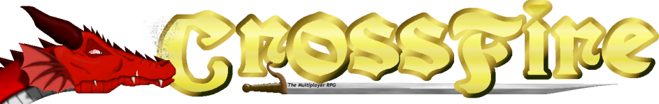
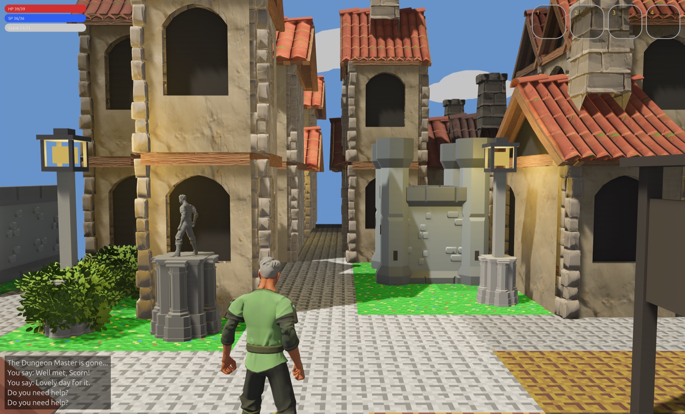
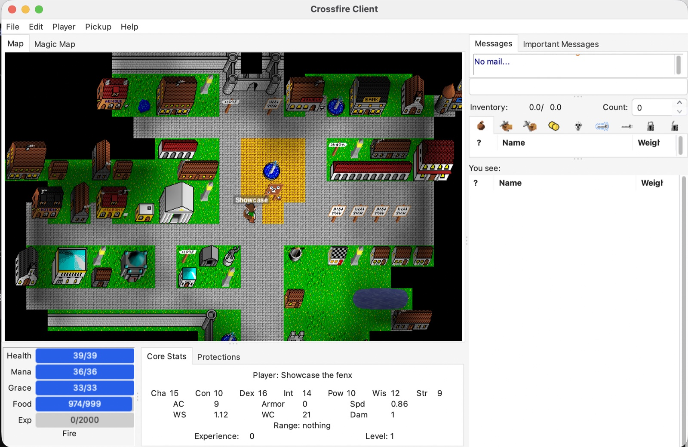
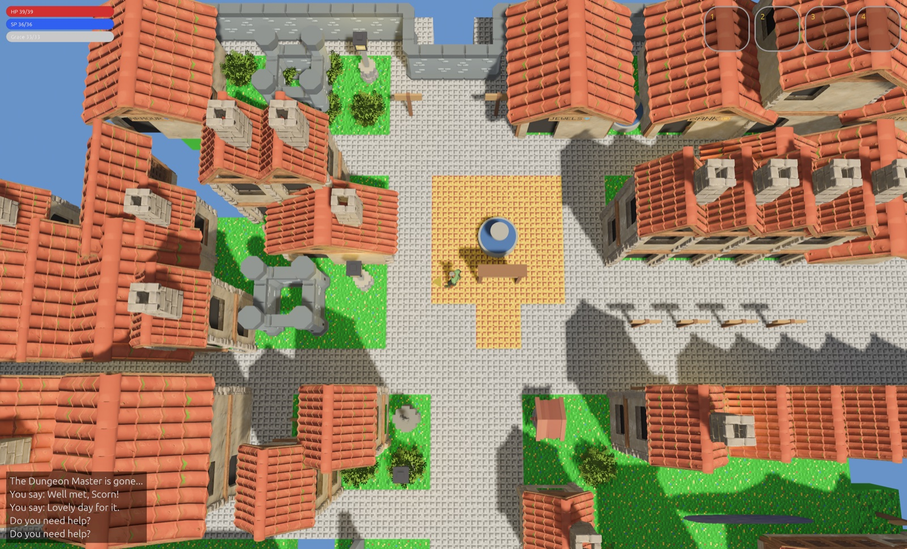
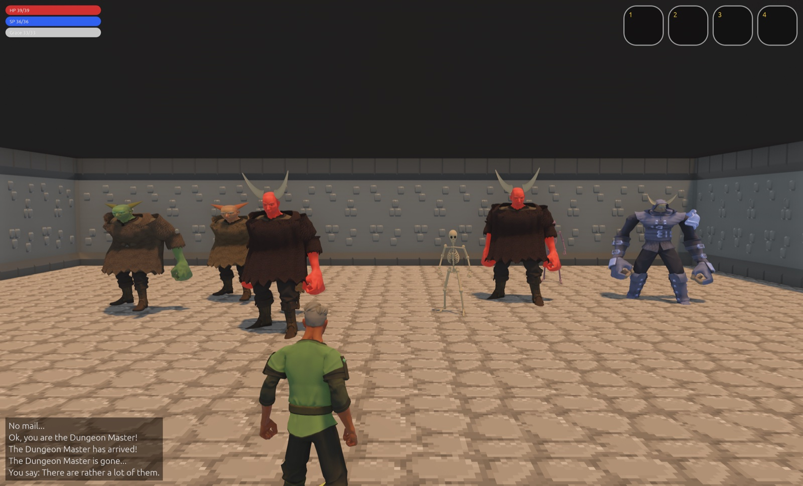
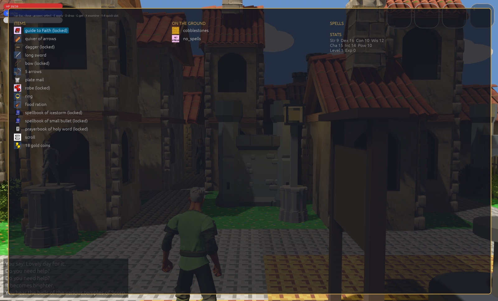
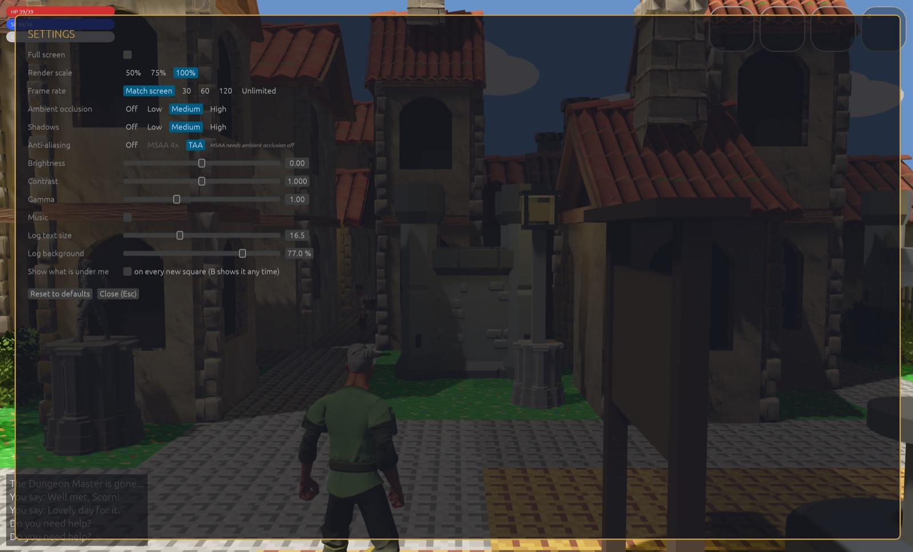

# Crossfir3d

A 3D client for [Crossfire](https://crossfire.real-time.com/), the free multiplayer
adventure game, written in Rust. It plays on normal Crossfire servers (1.75.0 and
newer): the same world, quests and players as every other Crossfire client, drawn in
3D. Licence: GPLv2 or later.



## Before and after

| The classic 2D client | Crossfir3d |
|---|---|
|  |  |

The same square of Scorn, on the same server.

### The top view

Press **Tab** for a top view, north up, much like the classic clients' map. Arrow keys
then move north, east, south and west, as they always did, so you can play the way you
are used to and still see the world in 3D. **Tab** again (or **C**) goes back behind
your character. The mouse wheel, a trackpad pinch, or two-finger scroll zooms the top
view in and out.



## Dungeons

Indoors (a dungeon, cave or house) the sky goes: a stone ceiling closes over you,
the walls rise to meet it, and torchlight takes the place of the sun.



## Screens

Inventory (**I**), key bindings (**O**) and settings (**Escape**) are overlays: they
open over the game, which goes on behind them, darkened so the text is easy to read.
Close them with the same key or **Escape**.

| Inventory | Key bindings | Settings |
|---|---|---|
|  |  |  |

Every class has its own look: see [docs/classes.md](docs/classes.md).

## The Crossfire community

Crossfir3d is an independent client. The game, its server, maps and art are made by
the Crossfire project, which has been running since 1992.

- Home page, downloads and other clients: <https://crossfire.real-time.com/>
- Servers to play on: [metaserver](https://crossfire.real-time.com/metaserver2/meta_html.php)
- Wiki: <https://wiki.cross-fire.org/>
- Forum: <https://forum.cross-fire.org/>
- Chat: [Discord](https://discord.gg/CCQqbqu) and [IRC on Libera Chat](https://crossfire.real-time.com/irc/index.html)
- Mailing lists: [crossfire](http://mailman.metalforge.org/mailman/listinfo/crossfire/) (discussion), [crossfire-announce](http://mailman.metalforge.org/mailman/listinfo/crossfire-announce)
- Source code: [SourceForge](https://sourceforge.net/projects/crossfire)
- News: [Mastodon](https://mastodon.social/@crossfiremrpg), [Bluesky](https://bsky.app/profile/crossfireproject.bsky.social)
- World map: [Crossfire Atlas](https://www.crossfireatlas.net/)

The Crossfire logo is by Lauwenmark (pencil original) and the Crossfire team (colour),
under Lauwenmark's licence: see
[docs/images/crossfire-logo-LICENSE.txt](docs/images/crossfire-logo-LICENSE.txt).

Design: `docs/superpowers/specs/2026-10-17-crossfir3d-design.md`

## Run a local server (macOS, needs Homebrew)

```sh
scripts/server.sh build   # once: clones server, arch, maps into upstream/ and builds
scripts/server.sh run     # listens on localhost:13327
```

`build` also clones the Crossfire sound pack to `upstream/crossfire-sounds`; the client
plays sounds and music from there (or from `$CROSSFIR3D_SOUNDS`).

## Run the client

```sh
cargo run --release -p crossfir3d
```

## Downloads (Mac and Windows)

Download `Crossfir3d.dmg` (M-series Macs) or `Crossfir3d-windows.zip` (Windows) from the
[releases](https://github.com/prototypo/Crossfir3d/releases). The login screen starts
with the Crossfir3d server, `play.crossfir3d.org:13327`; type another address to play
elsewhere (`localhost:13327` for your own). **Secure (TLS)** is on for every server
but your own computer, and the server's certificate is checked; turn it off for a
traditional Crossfire server (the password is then sent unprotected). The choice is
remembered per server (`plain-servers.txt` next to the settings). The login screen remembers the accounts used on this
computer and their characters (`~/Library/Application Support/Crossfir3d/accounts.txt`,
never the password): pick a character there to play it at once.

They are not signed, so the system warns the first time:

- **Mac:** drag Crossfir3d to Applications and open it. When macOS stops it, open
  System Settings > Privacy & Security and click "Open Anyway".
- **Windows:** unzip the folder and run `crossfir3d.exe`. When SmartScreen stops it,
  click "More info", then "Run anyway". Keep the `assets` and `sounds` folders next to it.

## Linux

There is no download for Linux yet. Build and run it from the source instead. You
need [Rust](https://rustup.rs) and Bevy's
[Linux packages](https://github.com/bevyengine/bevy/blob/main/docs/linux_dependencies.md)
(on Debian or Ubuntu: `sudo apt install g++ pkg-config libx11-dev libasound2-dev libudev-dev libxkbcommon-x11-0`).

```sh
git clone https://github.com/prototypo/Crossfir3d.git
cd Crossfir3d
git clone --depth 1 https://git.code.sf.net/p/crossfire/crossfire-sounds upstream/crossfire-sounds
cargo run --release -p crossfir3d
```

## Making the downloads

To make them: `scripts/package.sh` builds the one for the computer it runs on, in
`dist/`. The Release workflow (`.github/workflows/release.yml`) builds both; run it by
hand from the Actions tab, or push a tag like `v0.1.0` to make a release.

## Characters

Log in with an account, then pick a character from the list or press "New character"
to choose race, class, rolled stats, and where to start (Scorn by default). The server
(as patched by `scripts/server.sh`) saves new characters too.

## Playing in 3D

The camera sits over your character's shoulder and turns to stay behind them. Arrow
keys work relative to the way you face, in every view: Up takes a step forward; Left
and Right turn you 90° and Down turns you round, without a step. Hold an arrow to turn,
then walk that way. The number pad and the old clients' vi keys walk by the compass
instead: 8 or **K** north, 6 or **L** east, 2 or **J** south, 4 or **H** west, and 7 9 1 3
or **Y** **U** **B** **N** for the diagonals. **Tab**
turns a top view (north up) on and off; **C** goes back to the view behind you. Hold
**F** to look at your character's face. **A** or **E** applies. The mouse wheel, a
trackpad pinch, and two-finger scroll zoom (the top view has its own zoom). When a
wall or house is in the way, the camera moves closer.

Walk into a monster to attack it (hold the arrow to keep attacking); **T** turns you to
face the nearest one. **Space** fires your readied bow or wand the way you face (ready
it from the inventory: **I**, select it, **E**); arrows and bolts fly as 3D arrows. When you are hit, the screen flashes red and the HP you lost
floats above you; "hit", "miss", and "killed!" float over the monster you attack, and
it flashes red when hit. (The server sends no monster health or damage numbers.)

The log in the bottom-left corner can be made easier to read in the Settings screen
(Escape): "Log text size" (the box grows with the text) and "Log background" (how
dark, in per cent).

When you step onto things, the log names them ("You are standing on: a sack, a long
sword, ..."). **V** shows the full list in the parchment box; the Settings screen's
"Show what is under me" opens it on every new square.

### Key bindings

**O** opens the key bindings screen: a keyboard with your bound keys in yellow, and
your spells and skills beside it. Pick a spell or skill, then pick keys (click them, or
press the real combination, such as option + 6), and press **Bind**. A key bound with
modifiers has a ring in each modifier's colour. Picking a key the game already uses
asks first. A bound spell casts the way you face; a bound skill is used.

The old clients' commands also work in the command box (**Enter**): `bind cast burning
hands` (then press the key), `bind -g ...` for all your characters, `bind -e ...` to put
the command in the box instead of sending it, `unbind` to list them, `unbind 2` to
remove one, `unbind reset` to remove all. Bindings are saved in
`~/Library/Application Support/Crossfir3d/keys.txt`. Escape, O and Enter alone can
never be bound.

Shops are one-storey houses with a painted sign and icon (JEWELS, BANK, MAGIC, ...).
Standing on a house's squares (a shop's entrance row, say) shows you on its
doorstep; apply goes in. Leaving a shop, or stepping south off its squares, puts you
on the square in front of the door. With your back to a wall the camera comes in
close, first-person. Houses, walls, gates, trees, rocks, wells,
fountains, and signs are 3D. Players are one 3D body (with a "Broad" or "Slim"
build, chosen on the new-character screen), sized and coloured for their race. Your
character holds the weapon, bow, and shield in use. Everything else is still a
picture card.

Most of the 3D world is made for this project, in code: buildings, furniture, props,
item families (swords, rings, potions, ...), hats, capes and other class pieces, the
people-based monsters and the skeletons (`crates/crossfir3d/src/`, chiefly
`buildings.rs`). Rarer items are made from their Crossfire picture by
`experiments/sprite3d/voxel.py` (`assets/models/auto/`), so they keep the picture's
licence (GPL-2.0-or-later). The rest are CC0 model packs by Quaternius, KayKit and
Kenney, in `assets/models/` with their licences. `assets/models.txt` says which
picture becomes which model.
`assets/models/MISSING.md` lists what the free tiers lack. To change the picked
models: `scripts/get-models.sh` (download, needs a browser for itch.io), then
`python3 -I scripts/pick_models.py`.

Goblins, trolls, ogres, golems, demons and gnolls are built from the people's body,
reshaped and in rags; skeletons are bones built on the same body. No paid models
are used.

## Settings

Escape in game (or "Settings" on the login screen) opens the settings:
window/full screen, render scale, frame rate, ambient occlusion, shadows,
anti-aliasing, brightness, contrast, gamma, and music on/off (M still mutes
all sound). They are saved to
`~/Library/Application Support/Crossfir3d/settings.txt` (override with
`CROSSFIR3D_SETTINGS`). The sun follows the server's game clock
(`CROSSFIR3D_HOUR=14` forces an hour, for screenshots): a blue sky with drifting
clouds by day, a warm glow round the low sun at dawn and dusk, and stars at night.
Wells and other one-square things stay in view when you stand on them.

## Developer switches

- `CROSSFIR3D_LOGIN=account:password:character[:new]` logs in to `localhost:13327` at start (creates
  the character in Scorn if it does not exist; `:new` creates the account if it
  does not exist).
- `CROSSFIR3D_COMMANDS="cmd1;cmd2"` sends game commands on entering the game.
- `CROSSFIR3D_CA=file.pem` also trusts these certificates (a test gateway's own).
- `CROSSFIR3D_SCREEN=newchar[:race_arch]` opens the new-character screen;
  `=inventory`, `=keys` or `=settings` opens that screen in game; `=top` starts in
  the top view.
- `CROSSFIR3D_KEYS=file` reads and saves key bindings there instead of
  `~/Library/Application Support/Crossfir3d/keys.txt`.
- `CROSSFIR3D_SCREENSHOT=file.png` (with `CROSSFIR3D_SCREENSHOT_AT=seconds`)
  saves one screenshot and quits.
- `CROSSFIR3D_COMPARE=file` (lines `picture_name model1.glb model2.glb ...`, files
  under `assets/models`) keeps those pictures as cards with the models in a row
  beside them (`experiments/sprite3d/`).

## Tests

```sh
cargo test --workspace
# with the local server running:
cargo test -p crossfir3d --test live_server -- --ignored
```
