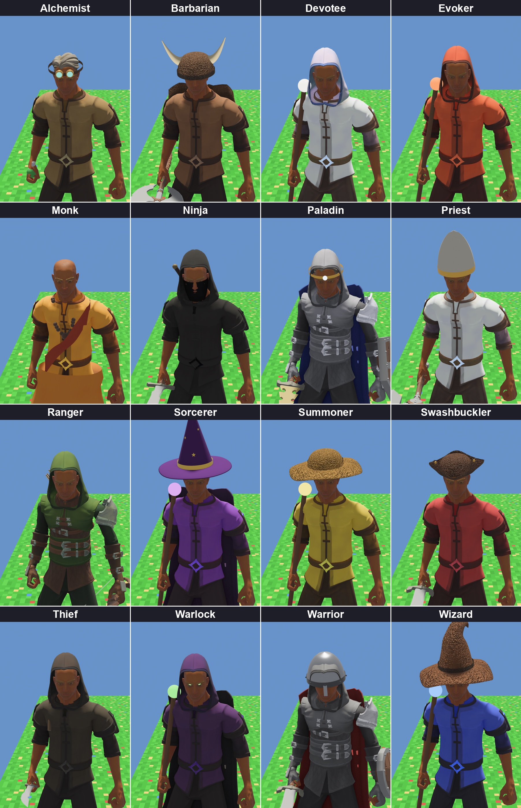
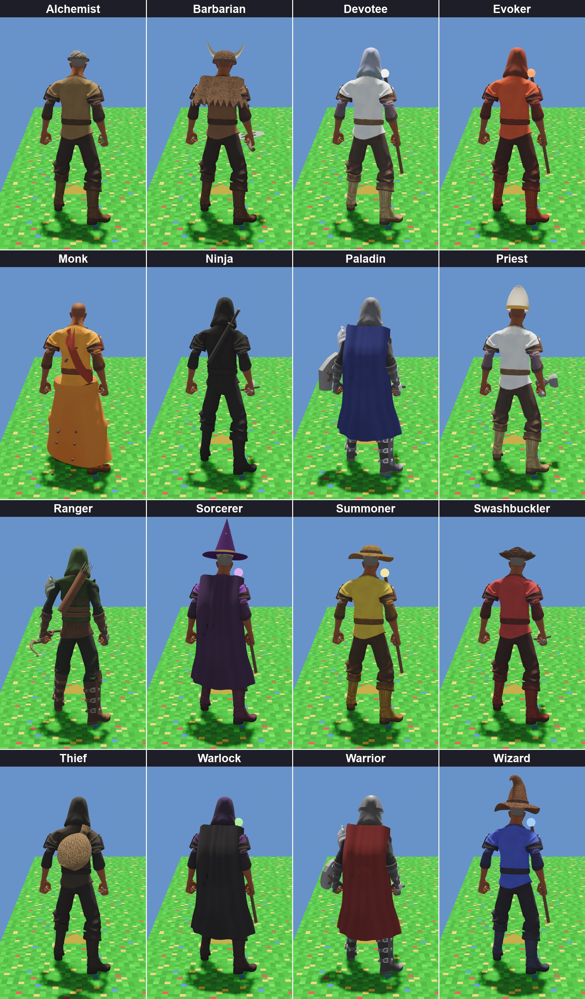

# Classes

Each class has its own look when it wears nothing else: clothes, something on the head,
something on the back, and what it carries. Armour or a helmet the character puts on
replaces the class's own. The looks are in `crates/crossfir3d/src/held.rs` (`class_look`).

| Class | Clothes | Head | Back | Carries |
|---|---|---|---|---|
| Alchemist | tan | goggles | | a potion |
| Barbarian | brown | leather cap with horns | fur cloak | a double axe |
| Devotee | white | white hood | | a staff, white orb |
| Evoker | orange | orange hood | | a staff, fire orb |
| Monk | saffron robe, sash, prayer beads | shaved | | |
| Ninja | black | black hood and face cloth | sheathed sword | a sword |
| Paladin | bright steel armour | gold circlet with a gem | blue cape | a gold sword, a heater shield |
| Priest | white | white mitre | | a hammer |
| Ranger | green leathers | green hood | quiver | a bow |
| Sorcerer | purple | tall starred hat | purple cape | a staff, violet orb |
| Summoner | yellow | wide travel hat | | a staff, gold orb |
| Swashbuckler | red | leather tricorn | | a sword |
| Thief | dark grey, no armour | hood | loot sack | a dagger |
| Warlock | dark purple | hood, glowing green eyes | black cape | a staff, green orb |
| Warrior | steel armour | steel helm with a nose guard | red cape | a sword, a round shield |
| Wizard | blue | floppy leather pointed hat | | a staff, blue orb |

Hats, capes and back pieces are built in code (`hat.rs`, `back.rs`, `robe.rs`), not
model files. Capes and the robe are skinned to the outfit's bones, so they move with it.
