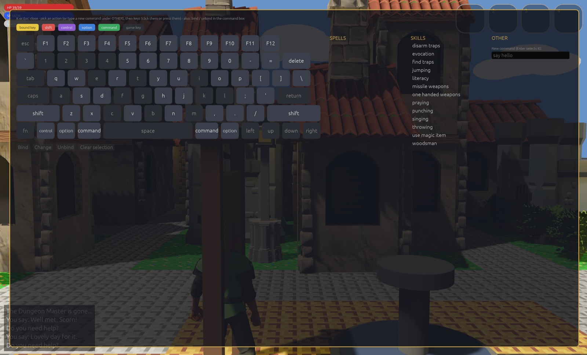

# Keys

All the keys Crossfir3d uses, and how to bind your own.

## Moving

| Keys | What they do |
|---|---|
| **Up** | Step forward, the way you face. |
| **Left**, **Right** | Turn 90°, without a step. |
| **Down** | Turn round, without a step. |
| Number pad **8 9 6 3 2 1 4 7** | Walk by the compass: 8 north, 9 north-east, 6 east, and so on round. |
| **K U L N J B H Y** | The same as the number pad, as in the old clients' vi keys: K north, U north-east, L east, N south-east, J south, B south-west, H west, Y north-west. |

Tap a key to turn that way. Hold it to walk. Walk into a monster to attack it; hold
the key to keep attacking.

## Playing

| Key | What it does |
|---|---|
| **A** or **E** | Apply (use): open a door, pull a lever, go into a shop. **E** also closes the parchment box. |
| **G** | Get what you stand on. |
| **1** to **4** | Use quick slot 1 to 4. |
| **Space** | Fire the prepared spell, or the readied bow or wand, the way you face. |
| **Shift** + an arrow | Fire without a turn: Up forward, Left to your left, Right to your right, Down behind you. |
| **Shift** + **8 9 6 3 2 1 4 7** or **K U L N J B H Y** | Fire by the compass. |
| **T** | Turn to face the nearest monster. |
| **V** | Show what is below you in the parchment box. |
| **R** | Make the log tall (20 lines) or short (5 lines). |
| **M** | Sound on or off. |

To prepare a spell, press **Enter** and type `cast magic bullet`. Then fire it with
**Space** or **Shift** + a direction key. To ready a bow or wand, press **I**, select
it, and press **E**.

Each press fires one time. Hold **Shift** and the direction keys fire: they do not
walk or turn you.

## Quick slots

The four slots at the top right of the screen hold an item or a spell.

1. Press **I** to open the inventory.
2. Select an item or a spell with the arrow keys.
3. Press **1**, **2**, **3** or **4** to put it in that slot.
4. Press **I** or **Escape** to close the inventory.

In the game, press **1** to **4** to use the slot. A spell is cast and fired the way
you face. A bow or wand is readied and fired. Any other item is applied. The slot does
nothing, and its ring is grey, if the character no longer has the item or spell.

Each character has its own slots, and they are saved at once. A slot cannot hold a
typed command: to run a command with a key, see [Binding your own keys](#binding-your-own-keys).

## The camera

| Key | What it does |
|---|---|
| **Tab** | Top view (north up) on or off. |
| **C** | Camera back behind you. |
| **F** (hold) | Look at your character's face. |
| Mouse wheel, pinch, two-finger scroll | Zoom. |

## Screens

| Key | What it does |
|---|---|
| **I** | Inventory. **I** or **Escape** closes it. |
| **O** | Key bindings. **O** or **Escape** closes it. |
| **Escape** | Settings. **Escape** closes it. |
| **Enter** | The command box: type a game command, such as `say hello`. |

## Binding your own keys

A binding makes a key (or a key with shift, control, option or command) run a spell,
a skill, or any game command.



### On the key bindings screen

1. Press **O**.
2. Pick a spell, a skill, or a command under OTHER. To add a new command, type it in
   the "New command" box under OTHER and press **Enter**.
3. Pick the keys. Click them on the keyboard, or press the real combination, such as
   option + 6.
4. Press **Bind**.

Bound keys are yellow. A key bound with modifiers has a ring in each modifier's colour:
red for shift, purple for control, blue for option, green for command. Each spell,
skill or command shows its keys beside it.

Pick a bound key to **Change** or **Unbind** it. A bound spell casts the way you face. A
bound skill is used.

### In the command box

The old clients' commands work too. Press **Enter**, then type:

| Command | What it does |
|---|---|
| `bind cast burning hands` | Then press the keys to bind. |
| `bind -g say hello` | Bind for all your characters, not only this one. |
| `bind -e shout ` | Put the command in the command box, so you can finish it, in place of sending it. |
| `unbind` | List your bindings, with numbers. |
| `unbind 2` | Remove binding 2 from that list. |
| `unbind reset` | Remove all of this character's bindings. |

### Rules

- A binding comes before a game key. If you bind **H**, H runs your command and no
  longer walks west. The game asks first. A binding on shift + a direction key takes
  the place of firing that way, without asking.
- **Escape**, **O** and **Enter** alone can never be bound: they are your way out.
- Keys the system uses can not be bound either: command + Q, W, H, M, Tab or Space
  on a Mac; Alt + F4 or Tab on Windows and Linux.
- A character's own binding comes before an all-characters binding on the same keys.

### The bindings file

Bindings are saved in `~/Library/Application Support/Crossfir3d/keys.txt`. You can edit
it by hand. Each line has five parts, with a tab between them:

```
character	modifiers	key	flags	command
```

- `character`: a character's name, or `*` for all characters.
- `modifiers`: `-` for none, or some of `shift`, `ctrl`, `option`, `cmd` joined by `+`,
  such as `shift+cmd`.
- `key`: a key name, such as `G`, `6`, `F3`, `Up` or `/`.
- `flags`: `e` to put the command in the command box, else `-`.
- `command`: the game command.

For example:

```
Anna	option	F	-	use_skill find traps
*	-	F5	-	say Well met!
```
